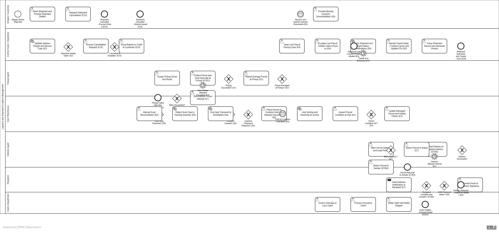

# Assignment 2 – Task Type & Gateway Justification
## Logistics & Shipment Exception Management

## Process Diagram Preview

---

## Task Type Justifications

| Task Name | Task Type | Justification |
|-----------|-----------|---------------|
| Book Shipment and Provide Details | **User Task** | Shipper manually enters shipment details via portal or counter. Requires human input — User Task. |
| Validate Address, Weight and Service Type | **Service Task** | Automated validation against address database, weight limits, and serviceable zones. No human action needed — Service Task. |
| Calculate Shipping Charges and Generate AWB | **Service Task** | Automated rate calculation and AWB (airway bill) number generation by the logistics system. Service Task. |
| Schedule Pickup and Assign Agent | **User Task** | Dispatcher manually assigns a pickup slot and agent from the scheduling system. Human decision — User Task. |
| Assign Pickup Driver and Route | **User Task** | Pickup manager assigns a specific driver and route. Manual assignment — User Task. |
| Collect Parcel and Scan Barcode | **User Task** | Pickup agent physically collects the parcel and scans barcode with a handheld scanner. Human physical action — User Task. |
| Reschedule Pickup | **User Task** | Agent or coordinator reschedules the pickup attempt manually. Human action — User Task. |
| Report Damage at Pickup | **User Task** | Agent documents visible damage and photographs the parcel. Manual documentation — User Task. |
| Hub Sorting and Scanning | **Service Task** | Automated conveyor-based barcode scanning and hub sorting system. Fully automated — Service Task. |
| Inspect Parcel Condition at Hub | **User Task** | Hub staff manually inspect parcel for damage, leakage, or integrity issues. Human inspection — User Task. |
| Isolate Damaged Parcel | **User Task** | Hub staff set aside damaged parcel and initiate claims paperwork. Human physical action — User Task. |
| Place Parcel on Customs Hold | **User Task** | Hub customs officer flags the shipment and requests documentation. Manual regulatory action — User Task. |
| Wait for Customs Clearance | **Intermediate Message Catch Event** | Hub waits for customs authority to issue clearance message. Models waiting for external authority event. |
| Line Haul Transport | **Service Task** | Automated vehicle tracking and dispatch scheduling for inter-hub transport. System-driven — Service Task. |
| Detect Scan Gap | **Service Task** | The tracking system automatically detects missing scan events and raises an alert. Automated — Service Task. |
| Manual Scan Reconciliation | **User Task** | Hub staff manually check physical inventory to reconcile missing scan records. Human action — User Task. |
| Track Shipment and Send Notifications | **Service Task** | Tracking system automatically updates parcel location and pushes SMS/email notifications. Automated — Service Task. |
| Handle Transit Delay | **User Task** | Dispatcher manually contacts carrier, updates ETA, and notifies customer. Human coordination — User Task. |
| Open Lost Parcel Trace Case | **User Task** | Control Tower opens a tracing ticket in the system. Human action — User Task. |
| Escalate Lost Parcel | **User Task** | Manager escalates to senior team and initiates claims process. Human escalation — User Task. |
| Notify Recipient | **Send Task** | System sends automated delivery notification (SMS/email). Outbound message — Send Task. |
| Attempt Delivery | **User Task** | Delivery agent physically delivers the parcel to the recipient. Manual physical action — User Task. |
| Return Parcel to Depot | **User Task** | Agent returns undelivered parcel to depot and updates system. Manual action — User Task. |
| Return to Sender | **User Task** | Agent or depot staff arranges return shipment to original sender. Human coordination — User Task. |
| Provide Proof of Delivery | **User Task** | Recipient signs or scans for delivery confirmation. Human acknowledgement — User Task. |
| Close Shipment Record | **Service Task** | System automatically closes the shipment, generates invoice, and archives records. Automated — Service Task. |
| Process Cancellation Request | **User Task** | Control Tower staff assess and process the cancellation manually. Human decision — User Task. |
| Issue Refund | **Service Task** | Automated refund credit issuance to customer account. System-driven — Service Task. |
| Assess Damage/Loss Claim | **User Task** | Claims officer manually assesses the damage or loss evidence. Human evaluation — User Task. |
| Process Insurance Claim | **User Task** | Claims officer files and processes the insurance claim. Manual — User Task. |
| Settle Claim and Notify Shipper | **Send Task** | Claims department sends settlement confirmation to shipper. Outbound notification — Send Task. |
| Provide Customs Documents | **User Task** | Shipper manually submits required customs documentation. Human action — User Task. |

---

## Gateway Justifications

| Gateway | Type | Justification |
|---------|------|---------------|
| Shipment Details Valid? (E2) | **Exclusive Gateway (XOR)** | Either details are valid (proceed) or invalid (return to customer for correction). One path only. |
| Pickup Successful? (E1) | **Exclusive Gateway (XOR)** | Exactly one outcome: pickup succeeded or failed. |
| Retry Pickup Successful? (E1) | **Exclusive Gateway (XOR)** | After rescheduling, either the retry works or max attempts are reached — binary decision. |
| Parcel Damaged at Pickup? (E3) | **Exclusive Gateway (XOR)** | Parcel is either damaged (claims path) or intact (hub path). Mutually exclusive. |
| Parcel Condition OK at Hub? (E3) | **Exclusive Gateway (XOR)** | Hub inspection yields damaged or intact result — one path. |
| Customs Clearance Required? (E6) | **Exclusive Gateway (XOR)** | Either the shipment needs customs clearance or it doesn't — binary decision. |
| Customs Cleared? (E6) | **Exclusive Gateway (XOR)** | Customs either clears the shipment or holds it further — one of two outcomes. |
| Scan Gap Resolved? (E9) | **Exclusive Gateway (XOR)** | Three mutually exclusive outcomes: scan OK, scan gap (manual recon), or parcel lost (trace). XOR with three branches. |
| Recipient Available? (E7/E8) | **Exclusive Gateway (XOR)** | Recipient is either available and willing to receive, or unavailable/refusing. One path. |
| COD Payment Made? (E8) | **Exclusive Gateway (XOR)** | COD is either paid (deliver) or refused (return). Mutually exclusive. |
| Delivery Successful? | **Exclusive Gateway (XOR)** | Delivery either succeeds (get POD) or fails (return to depot). One path. |
| Retry Delivery? (E7) | **Exclusive Gateway (XOR)** | After failed delivery and depot return: either retry (reschedule) or return to sender. |
| Cancellation Feasible? (E10) | **Exclusive Gateway (XOR)** | Cancellation is either feasible (refund) or not (shipment already in transit — cannot cancel). |

---

## Boundary Event Justifications

| Event | Type | Justification |
|-------|------|---------------|
| Max Pickup Attempts Timer (E1) | **Non-interrupting Timer Boundary** | Multiple retry attempts are allowed; the timer fires after the maximum window (e.g., 3 days × 1 attempt/day) to prevent infinite loops without stopping the current attempt. |
| Transit SLA Breach (E5) | **Non-interrupting Timer Boundary** | Transit continues; the timer fires in parallel to trigger delay notification and ETA update without cancelling the tracking task. |
| Delivery Attempt Timeout (E7) | **Non-interrupting Timer Boundary** | After 30 minutes waiting at delivery address, the agent must move on. Timer triggers depot return flow while delivery record remains active. |

---

## Message Event Justifications

| Message | Purpose | Justification |
|---------|---------|---------------|
| Customs Documents (E6) | Shipper → Hub | Shipper submits customs docs asynchronously after being notified of the hold. Intermediate Message Catch Event models this waiting pattern correctly. |
| Customs Clearance (E6) | Authority → Hub | Hub waits for clearance authority to signal approval. Another asynchronous external event. |
| Delivery Notification (E7) | System → Recipient | One-way outbound notification. Send Task correctly models this. |

---

*Generated for Academic BPMN 2.0 Assignment – Assignment 2*
